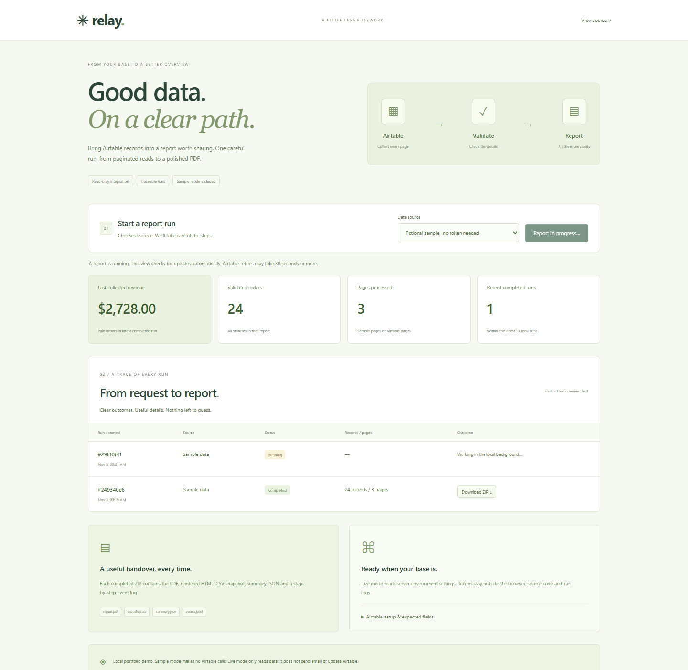

# Relay — Airtable Report Automation

A Python portfolio project by **Afrijal Indra Hendrawan**. Read paginated Airtable orders, validate the complete result, and create a PDF report with an inspectable data snapshot and event log. Includes a local run dashboard, background jobs, persistent history, bounded API retries and a credential-free sample mode.



## Run locally

Python 3.12+ recommended.

```sh
python -m venv .venv
# Windows:
.venv\Scripts\activate
# macOS/Linux: source .venv/bin/activate
pip install -r requirements.txt
python -m playwright install chromium
python app.py
```

Open http://127.0.0.1:8107 and click **Run report** using the fictional sample. After completion, download the ZIP. Windows users can launch `start-automation.bat` after setup; it uses installed Chrome when available. Alternatively set `REPORT_CHROME_CHANNEL=chrome` yourself. No token, base or external API call is needed for sample mode.

## Live Airtable setup

Create an Airtable personal access token with **data.records:read** and access to an isolated test base. Set these environment variables before starting the app or CLI:

```powershell
$env:AIRTABLE_TOKEN = '<your-personal-access-token>'
$env:AIRTABLE_BASE_ID = 'appXXXXXXXXXXXXXX'
$env:AIRTABLE_TABLE = 'Orders'
# Optional, to limit the source to one view:
$env:AIRTABLE_VIEW = 'Ready for reporting'
python app.py
```

These are placeholders, not working credentials. `.env.example` documents names; this project does **not** automatically load `.env` files. Never commit tokens. Server settings are never returned by the API. The browser receives only a boolean indicating whether the required settings look configured, not whether Airtable has accepted them.

Expected fields in the selected table/view:

| Airtable field | Supported value |
|---|---|
| Order ID | Unique 1–32 letters, digits, hyphens or underscores |
| Date | Date-only value in YYYY-MM-DD form |
| Customer | Non-empty text, at most 120 characters |
| Category | Non-empty text or single-select string, at most 120 characters |
| Amount USD | Nonnegative decimal, up to 999999999.99 and two fractional digits |
| Status | Paid, Pending or Refunded |

All fields are required. Empty Airtable fields may be omitted by its API; these are treated as validation errors. Linked-record arrays, attachments, formula errors and datetime values are not silently converted. Update the explicit `FIELDS` mapping in `pipeline.py` if your table uses different labels. Start with fictional data in an isolated base.

**Live access has not been verified against the owner's base:** no Airtable credentials were supplied. The real HTTP client is implemented, while pagination, API error and retry behavior are tested using injected responses. The sample JSON contains three simulated pages and is intentionally labeled separately from live requests.

## Automation from the terminal

```sh
python pipeline.py --mode sample --output-dir .data/my-first-run
python pipeline.py --mode airtable --output-dir .data/live-review
python run_automation.py --mode sample
```

`pipeline.py` requires a new output directory to preserve previous reports. `run_automation.py` creates a unique timestamped directory for each invocation and can be called by Windows Task Scheduler or cron. This repository does not install or create a recurring schedule. Use a single scheduled invocation at a time; the dashboard's single-worker lock does not coordinate independent CLI processes.

Exit code 2 means a run-level error. Validation/render errors produce a credential-safe `failure.json` with steps completed so far, not a partial PDF. Existing output directories are never replaced. Filesystem failures may prevent even an error log from being saved.

## API behavior

The live client uses **GET only**, requests up to 100 records per page and follows Airtable offsets. It spaces successful page requests by 250 ms, supports at most 50 pages/5,000 records and fails rather than silently truncating. Repeated offsets and record IDs stop the report to prevent loops/double counts. Redirects are not followed. Requests have connect/read timeouts and a 2 MB response-page limit.

429 responses wait at least 30 seconds; numeric Retry-After values are honored within a 30–120 second bound. Network failures and selected 5xx responses use bounded backoff. A page gets at most four attempts. Authentication, missing-resource, monthly-quota and other permanent errors stop promptly. Logs contain page/count/wait metadata, not Authorization headers, raw provider errors or customer fields.

These choices follow Airtable's [pagination guidance](https://support.airtable.com/articles/6292134965-getting-started-with-airtable-s-web-api), [API limits](https://support.airtable.com/articles/7735693959-Managing-API-call-limits-in-Airtable) and [personal access token documentation](https://support.airtable.com/articles/9934989703-creating-personal-access-tokens). Multiple processes or tools using the same base/token can still share rate limits. Large numeric Retry-After values are bounded by this demo; do not treat it as a distributed rate-limit coordinator.

## Report bundle

- `report.pdf`: selectable-text, multi-page A4 report with repeated headers and page numbers.
- `report.html`: the rendered, escaped source used to create the PDF.
- `snapshot.csv`: the validated records actually included in the report. Spreadsheet formula-like text is apostrophe-prefixed.
- `summary.json`: source, fetch statistics, totals and report metadata.
- `events.jsonl`: timestamped, credential-safe run events.

Collected revenue includes **Paid** orders only. Pending and Refunded are separate; refunded value is not subtracted from paid revenue in this mutually exclusive status model. Python Decimal preserves monetary calculations. The period spans the returned dates. All values are USD. Invalid records and duplicate business Order IDs fail the entire report; no automatic data repair or silent omission.

Multi-page reads are not a transactional snapshot. Avoid source edits during a run or use a stable reporting view. This is reporting automation, not an accounting ledger or source-authenticity check.

## Dashboard persistence

SQLite in `.data/runs/history.sqlite` stores local job metadata. Completed ZIP archives and failure logs are kept under `.data/runs`; these outputs may contain source customer data. The dashboard lists the latest 30 jobs, keeps only one worker active, rejects simultaneous starts and publishes a ZIP only after the report is complete. A server restart marks interrupted jobs failed so a user can explicitly retry them. No automatic retention/deletion is configured.

This is a loopback-only, single-process portfolio app with no login or multi-user access control. Do not expose the Flask development server publicly. No Airtable writeback, email delivery, webhook processing or unattended scheduler service is included.

## Test and examples

```sh
pip install -r requirements-dev.txt
python -m playwright install chromium
python -m pytest -q
```

Tests cover pagination, offset safety, retries without real waits, token redaction, record validation, exact totals, HTML escaping, real PDF content/page numbers, job locking/failure/recovery and CLI no-overwrite behavior. GitHub Actions runs the suite with Chromium on Python 3.12. Direct dependencies are pinned; transitive versions are not fully locked.

The fictional sample has **24 orders across 3 pages**, including **16 paid orders**. Paid: **$2,728.00**; pending: **$595.50**; refunded: **$760.50**. Sample mode makes zero HTTP requests to Airtable.

[Sample pages](examples/sample-pages.json) · [Example PDF](examples/expected/report.pdf) · [Generated bundle files](examples/expected/) · [Verification](docs/TEST-RESULTS.md) · [Mobile UI](docs/mobile.png)

## Structure and authorship

`airtable_client.py`: HTTP reads/pagination/retry. `pipeline.py`: validation, aggregation, PDF and CLI. `jobs.py`: single-worker state and atomic ZIP publication. `app.py`: local UI/API. `templates/report.html`: editable report design. `run_automation.py`: unique-output runner for external schedulers.

The owner selected requirements; Codex assisted with implementation and verification. All provided customer data is fictional. This is original portfolio work, not a paid client engagement. MIT licensed.
